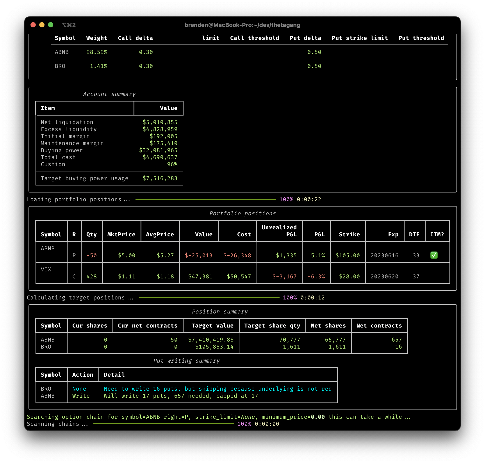

[](https://hub.docker.com/r/brndnmtthws/thetagang) [](https://pypi.org/project/thetagang/) [](https://hub.docker.com/r/brndnmtthws/thetagang) [](https://pypi.python.org/pypi/thetagang/)

# Θ ThetaGang Θ

_Beat the capitalists at their own game with ThetaGang 📈_

ThetaGang is an [IBKR](https://www.interactivebrokers.com/) trading bot that
started as a basic implementation of "The Wheel" strategy and has grown into a
broader, configurable portfolio automation tool. ThetaGang still supports a
modified version of The Wheel, and now also includes features like direct share
rebalancing, cash management, VIX call hedging, regime-aware rebalancing, and
exchange-hours gating.

## Risk Disclaimer

**⚠️ WARNING: Options trading involves substantial risk and is not suitable for
all investors.** Selling options can result in significant losses, potentially
exceeding your initial investment. Selling naked puts has theoretically unlimited
downside risk if the underlying asset goes to zero. This is not a "free money"
strategy—you are being compensated for taking on real financial risk.

Before using ThetaGang:
- Understand that you can lose money, especially in trending or volatile markets
- Ensure you have sufficient capital to handle worst-case scenarios
- Be prepared to own the underlying securities at potentially unfavorable prices
- Consider paper trading first to understand the mechanics and risks
- Consult with a financial advisor if you're unsure about the risks

## How it works

The strategy, as implemented here, is intended to be used to augment a
typical index-fund based portfolio with specific asset allocations. The
default configuration includes a diversified portfolio with SPY (40%), QQQ
(30%), TLT (20%), and smaller positions in individual stocks. This strategy
reduces risk, but may also limit gains from big market swings. By reducing
risk, one can increase leverage.

ThetaGang is quite configurable, and you can adjust the parameters to suit your
preferences and needs, but the default configuration is designed to be a good
starting point. ThetaGang makes some assumptions about how to run this strategy,
but you can tweak it to your liking by modifying the
[`thetagang.toml`](https://github.com/brndnmtthws/thetagang/blob/main/thetagang.toml)
file.

The main difference between ThetaGang and simply buying and holding index funds
is that this script will attempt to harvest volatility by selling options,
rather than buying shares directly. This works because implied volatility is
typically higher than realized volatility on average. Instead of buying shares,
you write puts. This has pros and cons, which are outside the scope of this
README.

ThetaGang can also be used in combination with other strategies such as PMCCs,
Zebra, stock replacement, and so forth. For these strategies, however, ThetaGang
will not manage long positions for you. You will need to manage these positions
yourself. ThetaGang will, however, continue to execute the short legs of these
strategies as long as you have the buying power available and set the
appropriate configuration (in particular, by setting
`write_when.calculate_net_contracts = true`).

### Running multiple strategies safely

If you want to run materially different strategies, it is strongly recommended
to use separate IBKR accounts (for example, separate linked sub-accounts) and
fund each one independently.

Mixing multiple strategy styles in one account can produce confusing or harmful
interactions because ThetaGang decisions are account-level. Buying power usage,
position targeting, rebalancing logic, option rolls, cash management, and hedge
logic all see the same combined portfolio and can interfere with each other in
ways that are hard to reason about.

In practice, one strategy per account is usually the cleanest setup:
- Cleaner risk boundaries and capital budgets
- Cleaner performance attribution
- Fewer unexpected cross-strategy side effects
- Easier debugging when behavior is not what you expected

Over time, additional features were added to support different portfolio
workflows and risk controls. You can enable or disable them independently via
config:

- Direct share rebalancing (buy-only and sell-only modes)
- Cash management via a cash-equivalent fund
- VIX call hedging
- Regime-aware rebalancing gates
- Exchange-hours enforcement

ThetaGang will try to acquire your desired allocation of each stock or ETF
according to the weights you specify in the config. To acquire the positions,
the script will write puts when conditions are met (config parameters, adequate
buying power, acceptable contracts are available, enough shares needed, etc).

ThetaGang will continue to roll any open option positions indefinitely, with the
only exception being ITM puts (although this is configurable). Once puts are in
the money, they will be ignored until they expire and are exercised (after which
you will own the underlying). When rolling puts, the strike of the new contracts
are capped at the old strike plus the premium received (to prevent your account
from blowing due to over-ratcheting up the buying power usage).

If puts are exercised due to being ITM at expiration, you will own the stock,
and ThetaGang switches from writing puts to writing calls at a strike at least
as high as the average cost of the stock held. To avoid missing out on upward
moves, you can limit the number of calls that are written with
`write_when.calls.cap_factor`, such as setting this to 0.5 to limit the number
of calls to 50% of the shares held.

Please note: this strategy is based on the assumption that implied volatility
is, on average, always higher than realized volatility. In cases where this
is not true, this strategy will cause you to lose money.

In the case of deep ITM calls, the bot will prefer to roll the calls to next
strike or expiration rather than allowing the underlying to get called away. If
you don't have adequate buying power available in your account, it's possible
that the options may get exercised instead of rolling forward and the process
starts back at the beginning. Please keep in mind this may have tax
implications, but that is outside the scope of this README.

In normal usage, you would run the script as a cronjob on a daily, weekly, or
monthly basis according to your preferences. Running more frequently than
daily is not recommended, but the choice is yours. Some features (like
regime-aware rebalancing) assume a daily cadence.



### VIX call hedging

ThetaGang can optionally hedge your account by purchasing VIX calls for the next
month based on specified parameters. The strategy is based on the [Cboe VIX Tail
Hedge Index](https://www.cboe.com/us/indices/dashboard/vxth/), which you can
read about on the internet. You can enable this feature in `thetagang.toml`
with:

```toml
[vix_call_hedge]
enabled = true
```

Default values are provided, based on the VXTH index, but you may configure
them to your taste. Key parameters include:

```toml
[vix_call_hedge]
enabled = true
allocation = 0.01  # 1% of buying power
close_hedges_when_vix_exceeds = 50  # Auto-close at high VIX
ignore_dte = 5  # Don't hedge if expiry within 5 days
```

See [`thetagang.toml`](https://github.com/brndnmtthws/thetagang/blob/6eab3823120c10c0563e02c5d7f30dfcc0e333fc/thetagang.toml#L294-L331)
for all available options.

Buying VIX calls is not free, and it _will_ create some drag on your portfolio,
but in times of extreme volatility–such as the COVID-related 2020 market
panic–VIX calls can provide outsized returns.

### Cash management

At the time of writing, interest rates have reached yields that make bonds look
attractive. To squeeze a little more juice, thetagang can do some simple cash
management by purchasing a fund when you have extra cash. Although you do earn
a yield on your cash balance, it's not the juiciest yield you can get, so a
little optimization might help you earn 1 or 2 extra pennies to take the edge
off your rent payments.

You can enable cash management with:

```toml
[cash_management]
enabled = true
fund = "SGOV"  # Default short-term treasury ETF
buy_threshold = 0.01  # Buy when cash > 1% of buying power
sell_threshold = 0.005  # Sell when cash < 0.5%

[cash_management.orders]
algo.strategy = "Vwap"  # Use VWAP for cash fund orders
```

This feature uses VWAP (Volume Weighted Average Price) orders by default to
minimize market impact when moving in and out of cash positions. Refer to
[`thetagang.toml`](https://github.com/brndnmtthws/thetagang/blob/4fc34653786ec17fe6ce6ec2406b2d861277f934/thetagang.toml#L330-L377) for all the options.

## Advanced Features

ThetaGang includes several advanced features that provide fine-grained control over your trading strategy:

### Candidate allocation review

Before editing portfolio weights, you can review a finite list of candidate
underlyings with the report-only analyzer. It checks option liquidity, target
DTE, event-window data and a constrained risk-adjusted allocation. The command
does not submit orders or modify the active configuration. The Markdown report
defaults to UTF-8 Chinese; use `--language en` for English labels.

```bash
uv run thetagang-analyze-candidates \
  --input data/candidate-analysis.example.json \
  --output data/candidate-analysis.md
```

If TWS/IB Gateway is already running, `--ibkr --config thetagang.toml
--symbols SPY,QQQ,TLT` collects option-chain and historical-price inputs in
read-only mode. It reads `runtime.account.market_data_type`; add
`--market-data-type 3` to try delayed data for this analysis only when IBKR
reports error 10197 for a competing live session. See
[`docs/strategy/CANDIDATE_ALLOCATION.md`](docs/strategy/CANDIDATE_ALLOCATION.md)
for the input format, market-hours behavior and review boundaries.

Missing option fields are reported as `data_insufficient`, separately from real
threshold failures and optional warnings. Add `--option-field-timeout 30
--json-output data/candidate-diagnostics.json` to wait longer and save per-contract
observations, including when screening or allocation fails. The default 30% weight
cap requires at least four eligible candidates to allocate 100%.

### Buy-Only Rebalancing

For symbols where options premiums are insufficient or unavailable, you can enable direct stock purchases for portfolio rebalancing:

```toml
[symbols.AAPL]
buy_only_rebalancing = true
buy_only_min_threshold_shares = 10  # Minimum shares to buy
buy_only_min_threshold_amount = 1000  # Minimum dollar amount to buy
```

This feature is useful for maintaining target allocations in stocks with limited options liquidity or when you want to dollar-cost average into positions.

### Regime-Aware Rebalancing

Regime-aware rebalancing lets you gate share rebalances on a simple regime
filter before acting. It builds a proxy series from the configured symbols’
daily closes, then checks for “choppy/mean-reverting” conditions using
choppiness and efficiency thresholds. If the regime passes, and allocations
drift beyond the soft relative band around target weights (or cash flow moves
all positions in the same direction), it queues share trades to move back
toward targets. A hard relative band acts as a safety rail and triggers even
when the regime filter fails, optionally rebalancing only partway back to
target. A cooldown prevents frequent soft-band rebalances and is based on
recent executions tagged with `tg:regime-rebalance`. When using this feature,
run the script once per day.

```toml
[regime_rebalance]
enabled = true
symbols = ["QQQ", "BTAL"]
lookback_days = 40
soft_band = 0.25  # +/-25% relative drift from target weight
hard_band = 0.50  # +/-50% relative drift from target weight
hard_band_rebalance_fraction = 1.0  # 1.0 = full to target, 0.5 = halfway
cooldown_days = 5
choppiness_min = 3.0
efficiency_max = 0.30
order_history_lookback_days = 30
shares_only = true  # disable option writes/rolls while rebalancing
```

### Exchange Hours Management

Control when ThetaGang operates relative to market hours:

```toml
[exchange_hours]
exchange = "XNYS"  # NYSE by default
action_when_closed = "wait"  # Options: "wait", "exit", "continue"
delay_after_open = 1800  # Wait 30 minutes after market open
delay_before_close = 1800  # Stop 30 minutes before market close
max_wait_until_open = 3600  # Max wait time if market is closed
```

### Strike Price Limits

Set boundaries for option strikes to prevent writing options at unfavorable prices:

```toml
[symbols.SPY.puts]
strike_limit = 400  # Don't write puts above $400

[symbols.SPY.calls]
strike_limit = 450  # Don't write calls below $450
```

### Write Threshold Sigma

Use standard deviation-based thresholds instead of fixed percentages:

```toml
[constants]
write_threshold_sigma = 1.0  # Write when 1 standard deviation from current price

[symbols.QQQ.puts]
write_threshold_sigma = 1.5  # More conservative for this symbol
```

When specified, sigma thresholds override regular `write_threshold` values.

### Advanced Rolling Features

#### Maintain High Water Mark
Prevent rolling calls to lower strikes:

```toml
[roll_when.calls]
maintain_high_water_mark = true
```

#### Close If Unable to Roll
Automatically close positions when suitable roll contracts aren't available:

```toml
[roll_when]
close_if_unable_to_roll = true
```

### Order Management

#### Price Adjustments
Automatically adjust limit orders after initial delay:

```toml
[symbols.SPY]
adjust_price_after_delay = true  # Adjusts to midpoint after delay
```

#### Algorithm Configuration
Customize order execution algorithms:

```toml
[orders.algo]
strategy = "Adaptive"
params.priority = "Patient"  # Options: "Urgent", "Normal", "Patient"
```

### Position Management

#### Calculate Net Contracts
Enable for spread strategies (PMCCs, calendars):

```toml
[write_when]
calculate_net_contracts = true
```

#### Excess Only for Calls
Write calls only on shares exceeding target allocation:

```toml
[write_when.calls]
excess_only = true
```

#### No Trading Flag
Temporarily disable trading for specific symbols:

```toml
[symbols.TSLA]
no_trading = true  # Monitor only, no trades
```

### API Configuration

Fine-tune IBKR API behavior:

```toml
[ib_async]
api_response_wait_time = 60  # Seconds to wait for API responses
logfile = "ib_async.log"  # Enable API logging for debugging
```

### Target Limits

Set absolute caps on new contracts:

```toml
[target]
maximum_new_contracts = 10  # Absolute limit per run
maximum_new_contracts_percent = 0.5  # Or limit by percentage
```

## Project status

This project is, in its current state, considered to be complete. I'm open
to contributions, but I am unlikely to accept PRs or feature requests that
involve significant changes to the underlying algorithm.

If you find something that you think is a bug, or some other issue, please
[create a new issue](https://github.com/brndnmtthws/thetagang/issues/new).

## Requirements

The bot is based on the [ib_async](https://github.com/ib-api-reloaded/ib_async)
library, and uses [IBC](https://github.com/IbcAlpha/IBC) for managing the API
gateway. The bundled IBC configuration targets the current stable TWS/Gateway
version (see `IBC(1045, ...)` in the code).

To use the bot, you'll need an Interactive Brokers account with a working
installation of IBC. If you want to modify the bot, you'll need an
installation of Python 3.10 to 3.14 with the
[`uv`](https://docs.astral.sh/uv/) package manager.

One more thing: to run this on a live account, you'll require enough capital
to purchase at least 100 shares of the stocks or ETFs you choose. For
example, if SPY is trading at $300/share you'd need $30,000 available. You
can search for lower priced alternatives, but these tend to have low volume
on options which may not be appropriate for this strategy. You should
generally avoid low volume ETFs/stocks. If you don't have that kind of
capital, you'll need to keep renting out your time until you can become a
capitalist yourself.

## Installation

_Before running ThetaGang, you should set up an IBKR paper account to test the
code._

```console
pip install thetagang
```

It's recommended you familiarize yourself with
[IBC](https://github.com/IbcAlpha/IBC) so you know how it works. You'll need
to know how to configure the various knobs and settings, and make sure things
like API ports are configured correctly. If you don't want to mess around too
much, consider [running ThetaGang with Docker](#running-with-docker).

## Quickstart (paper trading)

1) Copy the sample config and edit the required fields:

```console
curl -Lq https://raw.githubusercontent.com/brndnmtthws/thetagang/main/thetagang.toml -o ./thetagang.toml
```

At a minimum, update:
- `account.number`
- `ibc.userid` and `ibc.password`
- `ibc.tradingMode = "paper"`
- your `symbols.<SYMBOL>.weight` allocations

If you're running locally (not Docker), update the Docker defaults:
- `ibc.ibcIni` should point to your local `config.ini`
- `ib_async.logfile` should be a writable local path (or unset)
- `database.path` is relative to the config file location

2) Run a dry run to verify connectivity and config:

```console
thetagang --config ./thetagang.toml --dry-run
```

## Usage

```console
thetagang -h
```

Common flags:
- `--config` path to a toml config (required)
- `--dry-run` show proposed orders without submitting, modifying, or canceling broker orders
- `--without-ibc` connect to a running IB Gateway/TWS you started yourself
- `-v/--verbosity` increase log verbosity (repeatable)

All CLI options support environment variables with the `THETAGANG_` prefix.
Example: `THETAGANG_CONFIG=./thetagang.toml`.

Dry runs still connect to IBKR for account and market data and can write local
logs, order intents, and database snapshots. Broker order mutations are blocked
by the IBKR adapter as well as skipped by the normal dry-run workflow.

When `runtime.account.cancel_orders` is enabled, startup cancellation applies
only to unfinished orders in the configured account, for managed symbols, with
a ThetaGang `orderRef` beginning with `tg:`. New orders use the `tg:order` prefix;
enqueueing appends a unique submission identifier. Strategy prefixes such as
`tg:regime-rebalance:SPY` are preserved, as is the complete reference during
repricing. Manual orders, orders from other accounts,
and older untagged orders are left untouched. Review older untagged working
orders before a live run, since they are no longer canceled automatically.

## Execution recovery and batch checks

Every CLI run holds a local account lock. The execution journal is independent
of the optional SQLite database and is written atomically before each real
submission or amendment. These optional settings show their defaults:

```toml
[runtime.execution]
state_directory = "~/.local/state/thetagang"
funds_buffer = 100.0
order_fee_buffer = 5.0
```

All configurations and clients trading the same account on this machine must
use the same persistent state directory. Preserve it across container restarts
and upgrades. The lock does not coordinate separate hosts or manual trading.
Amounts above are in the account's base currency. The journal stores order
references, quantities, contract identifiers and broker state, without login
credentials; its filename hashes the account number.

After connecting, ThetaGang checks open orders, completed orders and executions
before planning. Startup cancellations must be confirmed. An unresolved prior
submission, including a working order when cancellation is disabled, stops new
submissions. A missing history entry is not proof that an order failed. A runtime
disconnect ends the current run; reconnect events cannot rerun its strategies.
If recovery is blocked, inspect the reported references in TWS and reconcile
their final state with the journal. Keep the journal and diagnostic evidence;
do not delete it merely to make a retry proceed. Orders beyond the broker's
available history require manual investigation.

Strategy stages share a projected view of actual positions, remaining working
orders and queued orders. Position management excludes newly planned positions
from its close/roll candidates. Before the first submission, batch checks reject
duplicate or opposing instruments, stock overselling, insufficient call cover,
invalid prices/quantities, mixed currencies and excessive combined pending
debits. Pending sales and option credits do not fund cash sweeps or other orders.

Live runs also request broker what-if margin estimates for new orders and the
remaining portions of working orders. Only positive margin/equity costs and
estimated fees are reserved; another unfilled order's anticipated margin release
cannot offset them. Repricing repeats the risk checks. Missing data, unsupported
contracts or an over-budget batch stop execution instead of automatically
resizing orders. Existing working orders may be counted conservatively again
even if the broker has already reserved margin for them.

Current local checks support stocks, options with explicit multipliers, and
qualified same-multiplier combos, all in an explicitly reported account base
currency. They do not perform FX conversion. Dry runs perform local checks and
display plans, but never send what-if requests; they therefore do not verify
broker margin acceptance. Margin estimates and local locks cannot eliminate
market movement or concurrent changes made outside this process.

Run outcomes distinguish filled, working, partial failure, failure and unknown
states. Working orders can remain at the broker after a successful submission
run; rejected or unconfirmed orders no longer report success. Submission errors
stop the remaining queue and propagate to the CLI.

Changes and offline test evidence are recorded in
[the revision history](docs/REVISION_HISTORY.md) and
[the high-priority verification report](docs/verification/OPT-02-05.md).

## State Database

### Local Chinese dashboard

```sh
uv run thetagang-dashboard --config thetagang.toml
```

Open `http://127.0.0.1:8765/` and keep the process running; Ctrl+C stops it.
The dashboard reads execution history, account/position snapshots, order timelines,
fills and newly recorded strategy decisions from SQLite without connecting to IBKR.
It supports timezone selection and sanitized per-run JSON exports. Historical
statuses are observations, not live broker status; missing older decisions remain
unavailable. See the [Chinese guide](docs/DASHBOARD.md).

ThetaGang can persist a SQLite database with order activity, executions,
historical bars, account snapshots, and decision gates. By default, the database
is created relative to your config file, and it is reused across runs to build a
long-lived history.

```toml
[database]
enabled = true
path = "data/thetagang.db"
# url = "sqlite:////abs/path/thetagang.db"
```

For Docker runs, make sure the `data/` directory is inside the mounted config
volume so the database persists between runs.

## Up and running with Docker

My preferred way for running ThetaGang is to use a cronjob to execute Docker
commands. I've built a Docker image as part of this project, which you can
use with your installation. There's a [prebuilt Docker image
here](https://hub.docker.com/repository/docker/brndnmtthws/thetagang).

To run ThetaGang within Docker, you'll need to pass `config.ini` for [IBC
configuration](https://github.com/IbcAlpha/IBC/blob/master/userguide.md) and
[`thetagang.toml`](https://github.com/brndnmtthws/thetagang/blob/main/thetagang.toml) for ThetaGang. There's a sample
[`ibc-config.ini`](https://github.com/brndnmtthws/thetagang/blob/main/ibc-config.ini) included in this repo for your convenience.

The easiest way to get the config files into the container is by mounting a
volume.

To get started, grab a copy of `thetagang.toml` and `config.ini`:

```console
mkdir ~/thetagang
cd ~/thetagang
curl -Lq https://raw.githubusercontent.com/brndnmtthws/thetagang/main/thetagang.toml -o ./thetagang.toml
curl -Lq https://raw.githubusercontent.com/brndnmtthws/thetagang/main/ibc-config.ini -o ./config.ini
```

Edit `~/thetagang/thetagang.toml` to suit your needs. Pay particular
attention to the symbols and weights. At a minimum, you must change the
username, password, and account number. You may also want to change the
trading move from paper to live when needed. If you enable the database,
create `~/thetagang/data/` so the SQLite file is persisted.

Now, to run ThetaGang with Docker:

```console
docker run --rm -i --net host \
    -v ~/thetagang:/etc/thetagang \
    brndnmtthws/thetagang:main \
    --config /etc/thetagang/thetagang.toml
```

On macOS/Windows, `--net host` is not supported. Use explicit port mapping and
set `watchdog.host` to `host.docker.internal` in your config:

```console
docker run --rm -i \
    -p 7497:7497 \
    -v ~/thetagang:/etc/thetagang \
    brndnmtthws/thetagang:main \
    --config /etc/thetagang/thetagang.toml
```

Lastly, to run ThetaGang as a daily cronjob Monday to Friday at 9am, add
something like this to your crontab (on systems with a cron installation, use
`crontab -e` to edit your crontab):

```crontab
0 9 * * 1-5 docker run --rm -i -v ~/thetagang:/etc/thetagang brndnmtthws/thetagang:main --config /etc/thetagang/thetagang.toml
```

## Configuration Examples

### Conservative Portfolio
Focus on stability with major index ETFs:

```toml
[symbols.SPY]
weight = 0.50
delta = 0.20  # Lower delta for safer strikes

[symbols.TLT]
weight = 0.30
delta = 0.15

[symbols.GLD]
weight = 0.20
delta = 0.15
```

### Growth Portfolio with Hedging
Higher risk tolerance with VIX protection:

```toml
[symbols.QQQ]
weight = 0.60
delta = 0.30

[symbols.ARKK]
weight = 0.30
delta = 0.35

[symbols.IWM]
weight = 0.10
delta = 0.30

[vix_call_hedge]
enabled = true
allocation = 0.01  # 1% of buying power
```

### PMCC Strategy
Poor man's covered calls with net contract calculation:

```toml
[write_when]
calculate_net_contracts = true  # Essential for spreads

[symbols.SPY]
weight = 1.0
# Manage long calls separately
# ThetaGang will write short calls against them
```

### Market Hours Trading
Trade only during stable market hours:

```toml
[exchange_hours]
delay_after_open = 3600  # Wait 1 hour after open
delay_before_close = 3600  # Stop 1 hour before close
action_when_closed = "exit"  # Don't run outside hours
```

## Determining which ETFs or stocks to run ThetaGang with

I leave this as an exercise to the reader, however I will provide a few
recommendations and resources:

### Recommendations

- Stick with high volume ETFs or stocks
- Careful with margin usage, you'll want to calculate the worst case scenario
  and provide plenty of cushion for yourself based on your portfolio

### Resources

- For discussions about selling options, check out
  [r/thetagang](https://www.reddit.com/r/thetagang/)
- For backtesting portfolios, you can use [this
  tool](https://www.portfoliovisualizer.com/backtest-portfolio) and [this
  tool](https://www.portfoliovisualizer.com/optimize-portfolio) to get an idea
  of drawdown and typical volatility

## Running without IBC

If you already run IB Gateway/TWS manually, you can skip IBC management:

```console
thetagang --config ./thetagang.toml --without-ibc
```

Ensure the following match your gateway settings:
- `watchdog.host`, `watchdog.port`, `watchdog.clientId`
- `ib_async.api_response_wait_time` for slower connections

## Development

Check out the code to your local machine and install the Python dependencies:

```console
# Install the pre-commit hooks
uv run pre-commit install
# Run thetagang
uv run thetagang -h
```

## FAQ

| Error | Cause | Resolution |
|---|---|---|
| Requested market data is not subscribed. | Requisite market data subscriptions have not been set up on IBKR. | [Configure](https://www.interactivebrokers.com/en/software/am3/am/settings/marketdatasubscriptions.htm) your market data subscriptions. The default config that ships with this script uses the `Cboe One Add-On Bundle` and the `US Equity and Options Add-On Streaming Bundle`. **Note**: You _must_ fund your account before IBKR will send data for subscriptions. Without funding you can still subscribe but you will get an error from ibc. |
| No market data during competing live session | Your account is logged in somewhere else, such as the IBKR web portal, the desktop app, or even another instance of this script. | Log out of all sessions and then re-run the script. |
| `ib_async.wrapper ERROR Error 200, reqId 10: The contract description specified for SYMBOL is ambiguous.` | IBKR needs to know which exchange is the primary exchange for a given symbol. | You need to specify the primary exchange for the stock. This is normal for companies, typically. For ETFs it usually isn't required. Specify the `primary_exchange` parameter for the symbol, i.e., `primary_exchange = "NYSE"`. |
| IBKey and MFA-related authentication issues | IBKR requires MFA for the primary account user. | Create a second account with limited permissions using the web portal (remove withdrawal/transfer, client management, IP restriction, etc permissions) and set an IP restriction if possible. When logging into the second account, ignore the MFA nags and do not enable MFA. A [more detailed set of instructions can be found here](https://github.com/Voyz/ibeam/wiki/Runtime-environment#using-a-secondary-account), from a different project. |

## Stargazers over time

[](https://starchart.cc/brndnmtthws/thetagang)
