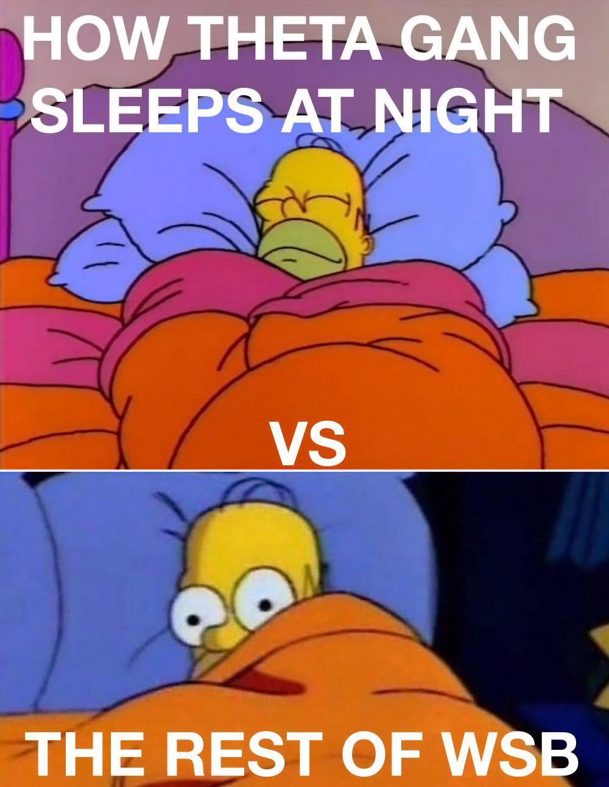
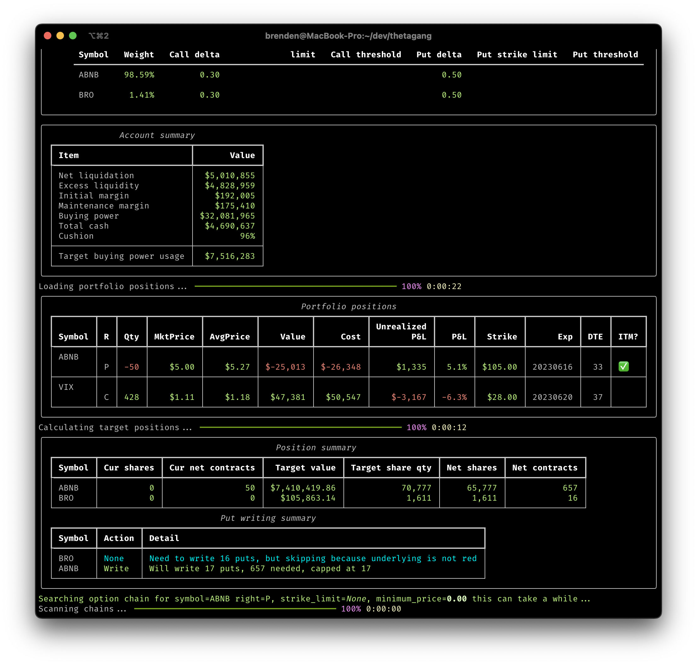

[](https://hub.docker.com/r/brndnmtthws/thetagang) [](https://pypi.org/project/thetagang/) [](https://hub.docker.com/r/brndnmtthws/thetagang) [](https://pypi.python.org/pypi/thetagang/)

[💬 Matrix chat](https://matrix.to/#/#thetagang:frens.io)

# Θ ThetaGang Θ



ThetaGang is a low-frequency, systematic portfolio execution tool for [Interactive Brokers (IBKR)](https://www.interactivebrokers.com/). Designed for long-horizon allocation and "get rich slowly" execution, it runs on a scheduled cadence (typically daily, weekly, or monthly via cron) to maintain target portfolio weights, manage hedges, and execute option or share orders within explicit risk controls.

Core capabilities:
- Stage-driven execution pipeline controlled by `run.strategies` or `run.stages`
- [Portfolio accounting model](docs/accounting.md) with isolated capital bases (`net_liquidation`, `wheel_buying_power`, `regime_rebalance`)
- Regime-aware equity rebalancing (`regime_rebalance`) with volatility targeting, absolute-trend rules, and soft/hard drift bands
- Direct share rebalancing (`buy_only`, `sell_only`, or `both`)
- Systematic options income and rolling (`wheel`: put/call writing, target DTE/delta selection, strike caps, and net-contract calculation for spreads/PMCCs)
- [Long-put tail hedging](docs/tail-hedging.md) (`tail_hedge`) and VIX call hedging (`vix_call_hedge`)
- Cash sweep management (`cash_management`) via short-term treasury ETFs (e.g., `SGOV`)
- [External decision providers](docs/external-decisions.md) for bounded target-weight multipliers and tail-harvest gating
- Exchange-hours enforcement, dry-run validation (`--dry-run`), per-symbol order supervision, and SQLite state/execution tracking

See [`thetagang.toml`](https://github.com/brndnmtthws/thetagang/blob/main/thetagang.toml) for the full configuration reference.



## Risk Disclaimer

**⚠️ WARNING: Trading equities and options on margin involves substantial risk and is not suitable for all investors.** Selling options and using leverage can result in losses exceeding your initial investment. Selling naked puts carries substantial downside risk if the underlying asset falls sharply. This is not free money: premiums compensate for real financial risk.

Before using ThetaGang:
- Understand that systematic strategies can lose money, especially in trending or volatile markets. The options-income approach assumes implied volatility exceeds realized volatility on average; when that fails, selling options loses.
- Maintain sufficient capital and margin cushion for worst-case drawdowns.
- Be prepared to take assignment of underlying securities at unfavorable prices when writing options.
- Test configurations thoroughly in a paper account and with `--dry-run` before live execution.

## Architecture & Strategies

ThetaGang executes an ordered pipeline of stages resolved from `run.strategies` (or `run.stages`) in [`thetagang.toml`](https://github.com/brndnmtthws/thetagang/blob/main/thetagang.toml). Only the stages required by the enabled strategies run.

### Running Multiple Strategies Safely

ThetaGang operates on account-level state: buying power, position targeting, rebalancing bands, option rolls, cash sweeps, and hedges all inspect the same account. To run materially different strategies without cross-strategy interference, isolate each strategy in its own IBKR sub-account with dedicated capital.

### Regime-Aware Rebalancing (`regime_rebalance`)

Rebalances equity positions across configured symbols when allocations drift beyond relative bands around target weights:
- **Soft band**: Gated by a choppiness/efficiency regime filter and a trading-session cooldown (tracked via `tg:regime-rebalance` order tags). Intended to harvest variance in choppy, mean-reverting markets.
- **Hard band**: Safety rail that bypasses the regime filter and cooldown when drift exceeds the hard threshold, optionally rebalancing partway back to target (`hard_band_rebalance_fraction`).
- **Flow & deficit rails**: Deploy inferred unallocated capacity or trim excess exposure when the rebalance base shifts. The flow rail infers capacity from base vs. sleeve value, not from broker deposits/withdrawals.
- **Target modifiers**: Optional per-symbol volatility targeting (`volatility_weight`), `absolute_trend` risk-off rules, and bounded [external decision providers](docs/external-decisions.md).

`regime_rebalance` enables only its equity-rebalance stage; it does not enable `wheel` option stages. (The legacy `strategies.regime_rebalance.shares_only` setting is deprecated and ignored.) Assumes a daily cadence; running more frequently than daily is not recommended.

```toml
[run]
strategies = ["regime_rebalance"]

[strategies.regime_rebalance]
enabled = true
symbols = ["QQQ", "BTAL"]
lookback_days = 40
soft_band = 0.25  # +/-25% relative drift from target weight
hard_band = 0.50  # +/-50% relative drift from target weight
hard_band_rebalance_fraction = 1.0  # 1.0 = full to target, 0.5 = halfway
cooldown_days = 5
choppiness_min = 3.0
efficiency_max = 0.30
order_history_lookback_days = 30

[strategies.regime_rebalance.risk]
margin_usage = 0.8  # Optional override of runtime.account.margin_usage
```

### Direct Share Rebalancing

When running `wheel`, symbols can be rebalanced directly with shares instead of—or alongside—options when premiums or liquidity are insufficient. Configure the v2 policy (the legacy `buy_only_rebalancing` symbol flags alone do not enable this; the v2 default mode is `off`):

```toml
[strategies.wheel.equity_rebalance.symbol_overrides.AAPL]
mode = "buy_only"  # buy_only | sell_only | both
min_threshold_shares = 10  # Minimum shares to buy
```

### Options Income & The Wheel (`wheel`)

The `wheel` strategy acquires and manages target symbol allocations by selling puts instead of buying shares outright, then writing calls on assigned shares:

1. **Put writing**: When a symbol is below its target allocation and conditions pass (buying power, DTE, delta, green/red day filters, minimum open interest), ThetaGang writes puts.
2. **Rolling**: Open short options are rolled when P&L reaches `roll_when.pnl` or DTE falls to `roll_when.dte` (subject to `min_pnl`, `max_dte`, and credit/strike constraints). By default, ITM puts are left to expire and take assignment (`roll_when.puts.itm = false`), while ITM calls roll out to avoid assignment (`roll_when.calls.itm = true`). Rolled put strikes are capped based on the prior strike, premium received, and buyback cost.
3. **Call writing**: Once shares are held, ThetaGang writes covered calls at or above the higher of average cost basis and any configured `strike_limit` (plus high-water-mark ratcheting when enabled). Upside can be left uncapped on a fraction of holdings using `write_when.calls.cap_factor`, `cap_target_floor`, or `excess_only = true`.
4. **Spreads & PMCCs**: Setting `write_when.calculate_net_contracts = true` accounts for user-managed long option legs (e.g., LEAPs in PMCCs, calendars, or ZEBRAs) when sizing short legs. ThetaGang does not open, roll, or guarantee coverage from the long legs: manage expirations yourself to avoid naked short exposure.

### Long-Put Tail Hedging (`tail_hedge`)

Maintains a rolling ladder of long out-of-the-money puts within a fixed annual cost budget (`annual_budget`), ranking candidate contracts near `target_dte` (default 180 DTE) by catastrophe-payout multiple. Entries are sliced across the year (`entries_per_year`); missed entries are not made up. Harvests trim profitable puts toward `harvest_target_weight` once the sleeve exceeds `harvest_trigger_weight` of the regime base, requiring a same-symbol hard-underweight rebalance buy. Requires persistent SQLite storage. See [Long-put tail hedging](docs/tail-hedging.md).

### VIX Call Hedging (`vix_call_hedge`)

Purchases monthly VIX calls scaled to VIXMO regimes based on the [Cboe VIX Tail Hedge Index (VXTH)](https://www.cboe.com/us/indices/dashboard/vxth/) methodology, and automatically closes hedges when spot VIX exceeds `close_hedges_when_vix_exceeds`.

```toml
[strategies.vix_call_hedge]
enabled = true
close_hedges_when_vix_exceeds = 50.0  # Auto-close at high VIX
ignore_dte = 5  # Ignore positions expiring within 5 days
```

See [`thetagang.toml`](https://github.com/brndnmtthws/thetagang/blob/main/thetagang.toml) for tiered VIXMO allocation tables.

### Cash Management (`cash_management`)

Sweeps cash above `target_cash_balance + buy_threshold` into a short-term treasury ETF (default `SGOV`) and sells back toward target when projected cash falls below `target_cash_balance - sell_threshold` (dollar amounts), using VWAP orders by default.

```toml
[strategies.cash_management]
enabled = true
cash_fund = "SGOV"  # Default short-term treasury ETF
target_cash_balance = 0
buy_threshold = 10000  # Buy fund when cash exceeds target by this much ($)
sell_threshold = 10000  # Sell fund when cash falls below target by this much ($)

[strategies.cash_management.orders.algo]
strategy = "Vwap"  # Use VWAP for cash fund orders
```

See [`thetagang.toml`](https://github.com/brndnmtthws/thetagang/blob/main/thetagang.toml) for full options.

## Execution & Risk Controls

### Exchange Hours Management

Gate execution on market hours (via `exchange_calendars` ISO codes):

```toml
[runtime.exchange_hours]
exchange = "XNYS"  # NYSE by default
action_when_closed = "wait"  # Options: "wait", "exit", "continue"
delay_after_open = 1800  # Wait 30 minutes after market open
delay_before_close = 1800  # Stop 30 minutes before market close
max_wait_until_open = 3600  # Max wait time if market is closed
```

### Strike Price Limits

Cap put strikes (upper bound) and floor call strikes (lower bound):

```toml
[portfolio.symbols.SPY.puts]
strike_limit = 400  # Don't write puts above $400

[portfolio.symbols.SPY.calls]
strike_limit = 450  # Don't write calls below $450
```

### Write Threshold Sigma

Gate option writes on daily log-return standard deviations instead of fixed percentages (overrides `write_threshold`):

```toml
[strategies.wheel.defaults.constants]
write_threshold_sigma = 1.0  # Write when 1 standard deviation from current price

[portfolio.symbols.QQQ.puts]
write_threshold_sigma = 1.5  # More conservative for this symbol
```

### Rolling Controls

#### Maintain High Water Mark
Prevent rolling calls to lower strikes:

```toml
[strategies.wheel.defaults.roll_when.calls]
maintain_high_water_mark = true
```

#### Close If Unable to Roll
Close profitable short positions when no qualifying roll contract is found (requires `roll_when.max_dte` set, with the position DTE at or below it):

```toml
[strategies.wheel.defaults.roll_when]
close_if_unable_to_roll = true
max_dte = 180  # Required: close only applies when DTE <= max_dte
```

### Order Management

Limit-order repricing is opt-in per symbol. Either set `adjust_price_after_delay = true` (one legacy midpoint-averaging adjustment after a random delay within `runtime.orders.price_update_delay`) or configure a per-symbol `execution` policy with `fill_timeout` for supervised repricing at the configured bid/ask/mid quote. Otherwise unfinished DAY limit orders stay working at the broker.

#### Per-Symbol Execution Policies

Per-symbol repricing and fallback behavior is opt-in. Without an `execution`
table, ThetaGang leaves unfinished DAY limit orders working at the broker, but
the final order check emits an `ALERT` and exits non-zero whenever any submitted
order is rejected or not fully filled.

```toml
[portfolio.symbols.SPY.execution]
buy_price = "ask"                # bid | ask | mid
sell_price = "bid"               # bid | ask | mid
fill_timeout = 300               # Supervise this order for five minutes
on_timeout = "marketable_limit"  # leave_open | cancel | marketable_limit | market
on_inactive = "marketable_limit" # Same actions when the broker rejects the order (defaults to on_timeout)
final_wait = 30                  # Wait 30 seconds for a replacement to fill
```

The configured quote is used for initial submission and, when `fill_timeout`
enables supervision, subsequent repricing. Using the ask for buys and the bid for
sells is the aggressive, marketable configuration. At the timeout, a
`marketable_limit` replacement retains price protection by using the current ask
or bid. A raw `market` fallback is explicitly opt-in and is not supported for
combo orders. ThetaGang confirms cancellation of the original order and replaces
only its unfilled quantity; if cancellation or fill state is ambiguous, no
replacement is submitted. A replacement that has not filled after `final_wait`
seconds stays working at the broker, and the final order check reports it.
Tail-hedge orders retain their separate execution safeguards. Configured limit
prices also preserve the sign of combo orders and the `minimum_credit` floor, so
a credit order cannot be silently converted into a debit.

When the broker rejects an order, IBKR either reports the terminal `Inactive`
status or delivers a rejection error (code 201) that arrives as `Cancelled`;
ThetaGang logs the reason and records it as an `order_error` event. An unmatched
request ID is audited only when it can be scoped to the current live submission
batch; routine connection and unrelated request errors remain filtered. When one
order can be identified safely, the error is correlated back to that order.
`order_statuses` and rejection events also retain IBKR's `whyHeld` value. The
same `on_timeout` actions apply to rejected orders,
gated by `on_inactive` (which inherits `on_timeout` when unset): exactly one
replacement may be submitted for the unfilled quantity, and if the replacement
is itself rejected, nothing further is submitted. External cancellations
(error code 202), ThetaGang's own cancellations, and unrecognized error codes
are never replaced — classification fails closed. Setting
`on_inactive = "leave_open"` keeps rejected orders unreplaced.

#### Algorithm Configuration
Customize order execution algorithms:

```toml
[runtime.orders.algo]
strategy = "Adaptive"
params = [["adaptivePriority", "Patient"]]
```

### Position Management

#### Calculate Net Contracts
Enable for spread strategies (PMCCs, calendars):

```toml
[strategies.wheel.defaults.write_when]
calculate_net_contracts = true
```

#### Excess Only for Calls
Write calls only on shares exceeding target allocation:

```toml
[strategies.wheel.defaults.write_when.calls]
excess_only = true
```

#### No Trading Flag
Temporarily disable trading for specific symbols:

```toml
[portfolio.symbols.TSLA]
no_trading = true  # Monitor only, no trades
```

### API Configuration

Fine-tune IBKR API behavior:

```toml
[runtime.ib_async]
api_response_wait_time = 60  # Seconds to wait for API responses
logfile = "ib_async.log"  # Enable API logging for debugging
```

### Target Limits

Set absolute caps on new contracts:

```toml
[strategies.wheel.defaults.target]
maximum_new_contracts = 10  # Absolute limit per run
maximum_new_contracts_percent = 0.5  # Or limit by percentage
```

## Requirements

- An Interactive Brokers account (paper or live)
- [ib_async](https://github.com/ib-api-reloaded/ib_async) and [IBC](https://github.com/IbcAlpha/IBC) (bundled IBC config targets TWS/Gateway `1050`)
- Python 3.11–3.15 and [`uv`](https://docs.astral.sh/uv/) (for local development)
- For option-writing strategies (`wheel`), sufficient capital/margin to cover 100-share standard option contracts on liquid underlyings. Equity-only strategies (`regime_rebalance` or share rebalancing) can size in single shares.

## Installation

Test with an IBKR paper account before running live:

```console
pip install thetagang
```

Either configure a local [IBC](https://github.com/IbcAlpha/IBC) + TWS/IB Gateway installation, or [run ThetaGang with Docker](#up-and-running-with-docker).

## Quickstart (paper trading)

1) Copy the sample config and edit the required fields:

```console
curl -Lq https://raw.githubusercontent.com/brndnmtthws/thetagang/main/thetagang.toml -o ./thetagang.toml
```

- `account.number`
- `ibc.userid` and `ibc.password`
- `ibc.tradingMode = "paper"`
- your `symbols.<SYMBOL>.weight` allocations

Secrets don't need to live in the file: any config string supports `$VAR`,
`${VAR}`, and `${VAR:-default}` from the environment (e.g.
`password = "${IBKR_PASSWORD}"`), which is handy for `ibc.userid`,
`ibc.password`, and `account.number`. Unset variables without a default abort
startup with an error naming the variable.

If you're running locally (not Docker), update the Docker defaults:
- `ibc.ibcIni` should point to your local `config.ini`
- `ib_async.logfile` should be a writable local path (or unset)
- `database.path` is relative to the config file location

2) Run a dry run to verify connectivity and config:

```console
thetagang --config ./thetagang.toml --dry-run
```

## Usage

```console
thetagang -h
```

Common flags:
- `--config` path to a toml config (required)
- `--dry-run` show proposed orders without submitting trades
- `--without-ibc` connect to a running IB Gateway/TWS you started yourself
- `-v/--verbosity` increase log verbosity (repeatable)

All CLI options support environment variables with the `THETAGANG_` prefix.
Example: `THETAGANG_CONFIG=./thetagang.toml`.

## State Database

ThetaGang can persist a SQLite database with order activity, executions,
historical bars, account snapshots, and decision gates. Live fills are recorded
from IBKR's execution-detail event as they arrive; explicit execution-history
requests also backfill the same table idempotently. By default, the database is
created relative to your config file, and it is reused across runs to build a
long-lived history.

```toml
[runtime.database]
enabled = true
path = "data/thetagang.db"
# url = "sqlite:////abs/path/thetagang.db"
```

For Docker runs, make sure the `data/` directory is inside the mounted config
volume so the database persists between runs.

## Up and running with Docker

A prebuilt image is published at [`brndnmtthws/thetagang`](https://hub.docker.com/repository/docker/brndnmtthws/thetagang) with IBC and IB Gateway bundled.

Mount a directory containing [`thetagang.toml`](https://github.com/brndnmtthws/thetagang/blob/main/thetagang.toml) and IBC's `config.ini` (sample: [`ibc-config.ini`](https://github.com/brndnmtthws/thetagang/blob/main/ibc-config.ini)):

```console
mkdir ~/thetagang
cd ~/thetagang
curl -Lq https://raw.githubusercontent.com/brndnmtthws/thetagang/main/thetagang.toml -o ./thetagang.toml
curl -Lq https://raw.githubusercontent.com/brndnmtthws/thetagang/main/ibc-config.ini -o ./config.ini
```

Update `~/thetagang/thetagang.toml` with your symbols, weights, `userid`, `password`, `account.number`, and `tradingMode`. If `database.enabled = true`, create `~/thetagang/data/` so the SQLite database persists across container runs.

Run with Docker:

```console
docker run --rm -i --net host \
    -v ~/thetagang:/etc/thetagang \
    brndnmtthws/thetagang:main \
    --config /etc/thetagang/thetagang.toml
```

On macOS/Windows, `--net host` is not supported. Use explicit port mapping and
set `watchdog.host` to `host.docker.internal` in your config:

```console
docker run --rm -i \
    -p 7497:7497 \
    -v ~/thetagang:/etc/thetagang \
    brndnmtthws/thetagang:main \
    --config /etc/thetagang/thetagang.toml
```

To run daily Monday–Friday at 9:00 AM via `crontab -e`:

```crontab
0 9 * * 1-5 docker run --rm -i -v ~/thetagang:/etc/thetagang brndnmtthws/thetagang:main --config /etc/thetagang/thetagang.toml
```

## Configuration Examples

### Conservative Portfolio
Focus on stability with major index ETFs:

```toml
[portfolio.symbols.SPY]
weight = 0.50
delta = 0.20  # Lower delta for safer strikes

[portfolio.symbols.TLT]
weight = 0.30
delta = 0.15

[portfolio.symbols.GLD]
weight = 0.20
delta = 0.15
```

### Growth Portfolio with Hedging
Higher risk tolerance with VIX protection:

```toml
[portfolio.symbols.QQQ]
weight = 0.60
delta = 0.30

[portfolio.symbols.ARKK]
weight = 0.30
delta = 0.35

[portfolio.symbols.IWM]
weight = 0.10
delta = 0.30

[strategies.vix_call_hedge]
enabled = true
```

### PMCC Strategy
Poor man's covered calls with net contract calculation:

```toml
[strategies.wheel.defaults.write_when]
calculate_net_contracts = true  # Essential for spreads

[portfolio.symbols.SPY]
weight = 1.0
# Manage long calls separately
# ThetaGang will write short calls against them
```

### Market Hours Trading
Trade only during stable market hours:

```toml
[runtime.exchange_hours]
delay_after_open = 3600  # Wait 1 hour after open
delay_before_close = 3600  # Stop 1 hour before close
action_when_closed = "exit"  # Don't run outside hours
```

## Portfolio Selection Notes

- Use liquid ETFs or large-cap equities with tight bid-ask spreads (and high option open interest if trading options).
- Model worst-case drawdown and margin requirements before setting `margin_usage`. Useful backtesting tools: [Portfolio Visualizer Backtest](https://www.portfoliovisualizer.com/backtest-portfolio) and [Portfolio Optimization](https://www.portfoliovisualizer.com/optimize-portfolio).
- Community discussion: [r/thetagang](https://www.reddit.com/r/thetagang/).

## Running without IBC

If you already run IB Gateway/TWS manually, you can skip IBC management:

```console
thetagang --config ./thetagang.toml --without-ibc
```

Ensure the following match your gateway settings:
- `watchdog.host`, `watchdog.port`, `watchdog.clientId`
- `ib_async.api_response_wait_time` for slower connections

## Development

Check out the code to your local machine and install the Python dependencies:

```console
# Install the pre-commit hooks
uv run pre-commit install
# Run thetagang
uv run thetagang -h
```

## FAQ

| Error | Cause | Resolution |
|---|---|---|
| Requested market data is not subscribed. | Requisite market data subscriptions have not been set up on IBKR. | [Configure](https://www.interactivebrokers.com/en/software/am3/am/settings/marketdatasubscriptions.htm) your market data subscriptions. The default config that ships with this script uses the `Cboe One Add-On Bundle` and the `US Equity and Options Add-On Streaming Bundle`. **Note**: You _must_ fund your account before IBKR will send data for subscriptions. Without funding you can still subscribe but you will get an error from ibc. |
| No market data during competing live session | Your account is logged in somewhere else, such as the IBKR web portal, the desktop app, or even another instance of this script. | Log out of all sessions and then re-run the script. |
| `ib_async.wrapper ERROR Error 200, reqId 10: The contract description specified for SYMBOL is ambiguous.` | IBKR needs to know which exchange is the primary exchange for a given symbol. | You need to specify the primary exchange for the stock. This is normal for companies, typically. For ETFs it usually isn't required. Specify the `primary_exchange` parameter for the symbol, i.e., `primary_exchange = "NYSE"`. |
| IBKey and MFA-related authentication issues | IBKR requires MFA for the primary account user. | Create a second account with limited permissions using the web portal (remove withdrawal/transfer, client management, IP restriction, etc permissions) and set an IP restriction if possible. When logging into the second account, ignore the MFA nags and do not enable MFA. A [more detailed set of instructions can be found here](https://github.com/Voyz/ibeam/wiki/Runtime-environment#using-a-secondary-account), from a different project. |
