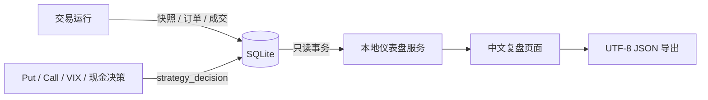

# 本地中文交易仪表盘

在项目目录执行：

```sh
uv run thetagang-dashboard --config thetagang.toml
```

浏览器打开 **http://127.0.0.1:8765/**。保留这个终端窗口；按 Ctrl+C 停止服务，下次重新执行同一命令。
无需启动 TWS，也无需为了查看历史再次运行交易程序。
端口被占用时使用 `--port 8766`；直接查看其他数据库使用 `--database /绝对路径/thetagang.db`，无需配置文件。

## 使用功能

- 运行历史：分页、可下单/预演模式筛选、结束结果、耗时与异常类型。
- 运行总览：账户净值、现金、维持保证金、配置资金基数、订单摘要和执行时间线。
- 订单与成交：期权合约、方向、数量、限价、状态变化、部分成交与关联成交回报。
- 持仓快照：每轮最新已留存的股票/期权、市值与浮动盈亏。
- 策略决策：新运行的 Put/Call 门槛、目标缺口、单次上限、筛选结果、VIX 预算和现金管理原因。
- 导出本次记录：UTF-8 JSON，包含页面使用的账户、持仓、订单与决策。
- 时区：北京时间、美东时间或 UTC，按具体日期处理夏令时。

首页默认选中当前历史页最近一条有订单计划的运行；没有订单时选最新一条。
左侧仍列出所有启动，包括失败和缺少结束信息的记录。

## 数据与边界

数据库路径读取自 `[runtime.database]`，兼容旧配置 `[database]`；相对路径以配置文件目录为基准。
页面通过只读 SQLite 事务读取，不创建数据库、不运行迁移、不加载交易执行入口、不连接券商。
服务仅监听 `127.0.0.1`，没有下单、撤单或改配置接口；页面资源无需外网。
网页和导出不会包含原始配置、密码或主机名。原数据库可能保有旧版原始配置，本功能不清理历史数据。

“可下单运行”仅表示没有设置 `--dry-run`，不代表 IBKR 实盘账户；原记录没有单独的券商账户环境标记。
“预演”表示程序自身的 dry-run 模式。

订单状态都是最后保存的观察结果，不是实时券商状态。刷新只读取本地数据库。
程序退出后发生的成交可能尚未回填，缺少成交回报不能解释为没有成交。
回报采集轮次可能晚于订单创建轮次；分别展示“关联成交”和“本轮收到的成交回报”。

状态首先按本轮订单号关联；有唯一有效 `permId` 时才读取后续同一永久订单号的状态。
跨轮次不单凭 `orderId` 关联。同一轮号码出现多个永久订单号时，状态标记为待核实。
原状态表没有 `clientId`，无永久订单号的历史记录仍存在身份信息不足的限制。
成交使用完整 `orderRef` 关联，不把部分成交或提交成功推算成全部成交。

权重图按 Wheel 配置资金基数比较股票市值与目标，未合并期权 Delta、风险因子或 Regime 动态目标，
不作为全账户风险敞口图。缺少历史配置/快照时显示不可用。

旧记录没有的决策原因显示“未留存”，不根据最终订单虚构触发依据。
新决策使用现有 `events` 表的 `strategy_decision` 事件，不需迁移；更新后运行交易程序才产生。
这不会调整交易规则或修复其他策略问题。展期、平仓和 Regime 的全部门槛尚未统一为新事件；
已存在的相关事件仍显示在时间线中。

历史缺少结束事件时显示“未记录结束”，不推断正在运行。新运行补记交易时段退出、启动失败和异常类型；
详细堆栈仍从终端/诊断日志查看。数据库初始化之前的配置错误无法写入该数据库。

## 维护

- 入口 `thetagang/dashboard.py`，静态资源 `thetagang/dashboard_assets/` 随 Python 包发布。
- 无额外运行依赖或前端构建步骤。
- 接口 `GET /api/runs?page=1&mode=all`、`GET /api/runs/<id>`、`GET /api/runs/<id>/export`。
- SQLite `mode=ro`、`query_only`；查询绑定参数、静态路径白名单、Host/Origin 校验。
- [验证记录](verification/DASHBOARD.md) · [修订留痕](REVISION_HISTORY.md)。


