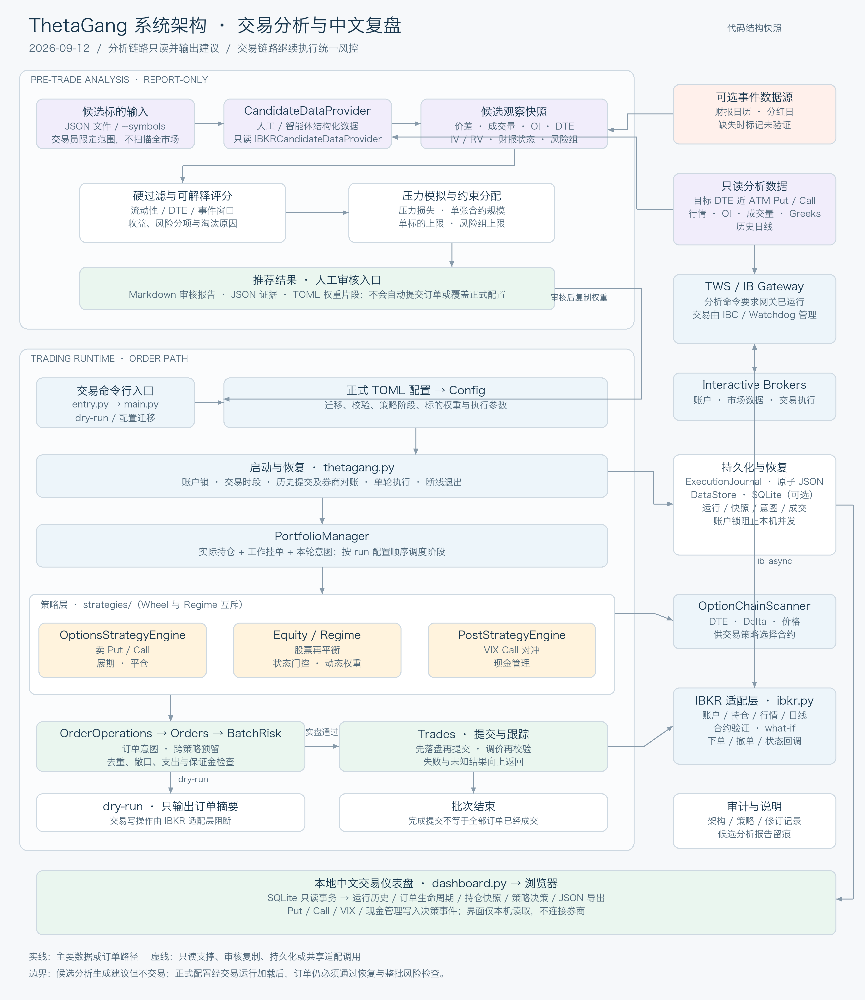

# ThetaGang 系统架构与优化建议

代码阅读与最近修订日期：2026-09-12。最高优先级 OPT-01 及全部高优先级 OPT-02 至 OPT-05 已完成本地实现与回归验证。当前已包含模拟模式隔离、失败结果传递、连续调价、账户锁与恢复日志、券商对账和整批风险检查，以及候选标的分析与权重建议第一版。中优先级事项继续保留待办。

交易策略的独立分析、阶段顺序和详细策略图见[交易策略分析](../strategy/README.md)。

修订过程和待实施事项见[修订记录](../REVISION_HISTORY.md)，五项隔离复现的原始结果见[验证记录](review-verification.txt)。

## 架构文件

- [PNG 图片，3600 × 4160](thetagang-architecture.png)：便于分享、插入文档。
- [SVG 矢量图](thetagang-architecture.svg)：便于放大、打印和调整图形。
- [Mermaid 源文件](thetagang-architecture.mmd)：便于维护模块和调用关系。
- [导出脚本](export_architecture.py)：用于从同一版式重新生成 SVG 和 PNG。
- [完整下载包](thetagang-architecture.zip)：包含图、源文件、说明和相关验证记录。

PNG / SVG 是排版后的架构概览，Mermaid 保留更细的模块连线。侧栏为共享能力及外部依赖，不表示这些 Python 类在独立进程运行。

新增的候选分析链路位于正式交易运行之前。交易员通过 JSON 或 `--symbols` 限定候选范围；`CandidateDataProvider` 接收人工或智能体提供的结构化数据，也可以通过只读 `IBKRCandidateDataProvider` 获取目标 DTE 附近的期权行情与历史日线。分析器执行流动性、DTE 和事件窗口硬过滤，再计算收益、风险、压力损失、单张合约规模以及单标的/风险组约束，最后生成 Markdown、JSON 和 TOML 权重片段。

该链路是报告模式：不会进入 `PortfolioManager`，不会提交订单，也不会自动覆盖正式 TOML。图中的虚线“审核后复制权重”表示交易员核对报告后才把建议纳入正式配置。财报日历目前是可选数据源，缺失时结果明确标记为未验证。具体输入和边界见[候选标的评估说明](../strategy/CANDIDATE_ALLOCATION.md)。

程序通过 CLI 启动，迁移并校验 TOML 配置，获得本机账户锁，检查交易时段，再连接 IB Gateway。连接后先核对历史提交及券商订单；管理器每次进程运行只执行一轮 manage，按 run 配置顺序调度策略。订单先入内存队列，经整批风险校验与实盘保证金预估后，先写恢复日志再提交；随后等待状态并按配置调整价格。断线时停止本轮执行。一个批次结束后退出，券商端仍可能有未成交工作订单。

Wheel 和 Regime 再平衡在配置层互斥。Regime 决策通过 EquityRebalanceEngine 构造股票订单；VIX 与期权策略共享合约扫描器。各阶段共用实际持仓、既有挂单和本轮意图的预计组合；平仓/展期不把新计划仓位视为已成交。现金管理扣除待发生支出及 Regime 预留现金，不提前使用未成交收入。

执行恢复日志是独立的 JSON 文件，不依赖可选 SQLite 数据库，提交前原子写入，并与账户锁共用持久化目录。DataStore 仍记录运行、账户持仓快照、订单意图、订单状态、成交和历史行情，并支持跨次运行的策略状态查询。

本地中文交易仪表盘通过独立的只读 SQLite 服务展示运行、账户/持仓、订单、成交和新决策事件；没有券商连接与交易接口。详见[仪表盘使用说明](../DASHBOARD.md)。

## 初次评估发现与修复进度

下表保留初次评估时的代码位置和修改前的问题描述，行号已随修订变化，不表示当前代码仍有同样问题。OPT-01 修复第一行；OPT-02、OPT-03 修复第二、三行；行情订阅和配置脱敏仍待处理。任务排期统一以[修订记录](../REVISION_HISTORY.md)为准。对应 [OPT-01 验证](../verification/OPT-01.md)及 [OPT-02 至 OPT-05 验证](../verification/OPT-02-05.md)均已归档。

| 优先级 | 代码依据与现状 | 建议及验证目标 |
| --- | --- | --- |
| P0 | `portfolio_manager.py:453`：initialize_account 不检查 dry_run；cancel_orders 开启时仍撤销匹配标的的挂单。筛选也没有显式限制订单归属。 | 将下单、改价、撤单统一经过执行权限检查；模拟模式只记录动作。撤单按账户和本程序订单标识限定。回归测试覆盖全部三类写操作。 |
| P1 | `trades.py:20`：提交遇到 RuntimeError 只记录日志；`portfolio_manager.py:826`：异常路径仍将 completion_future 设为 True。 | 定义明确的批次结果：成功、部分失败、失败、结果未知；向完成 Future 和 CLI 传播真实结果。正常挂单等待成交不应一概算失败。 |
| P1 | `portfolio_manager.py:1140`：一笔订单不适合调价时 return 退出整个循环，后续订单不再处理。`1160` 重建订单时还没有显式保留 account、tif、orderRef 等字段，意图关联也没有继续传递。 | 单笔跳过使用 continue；改价保留原始路由、有效期、归属和审计关联，仅更新价格。增加多订单测试及字段保留测试。字段遗漏在真实券商端的效果仍需验证。 |
| P1 | `ibkr.py:403`：reqMktData 后，正常完成或异常退出均没有 cancelMktData；`log.py:64` 一次调度全部任务。 | 为行情订阅建立明确的复用、引用计数和释放规则；一次性查询在 finally 清理。限制同时活跃的请求/订阅，增加合约与行情缓存，统一超时和可重试错误策略。 |
| P1 | `thetagang.py:88` 将 raw_config 传入 DataStore，`db.py:306` 原样保存 config_text。 | 配置入库前脱敏。若 TOML 含登录密码，当前数据库副本也会保留该值；保留可复现的非敏感配置与配置哈希即可。未读取用户的实际密码，也未检查现有数据库内容。 |

P0 表示建议优先处理的模拟模式边界问题；P1 表示执行可靠性或数据保护问题。

## 架构能力评估与落实状态

这些是从调用关系识别出的设计风险，未在真实券商环境复现事故。

1. **运行互斥与订单去重（OPT-04 已落实）。** 以下保留初次评估依据： `thetagang.py:96` 的连接事件每次调用 manage，当前入口未见运行互斥；`Orders` 只追加内存记录。增加账户级运行锁、批次状态和持久化意图标识。断线或提交结果未知时先向券商核对挂单与成交，再决定是否重试，避免把重复提交当成普通请求重试。
2. **统一的预计组合与资金预留（OPT-05 已落实）。** 以下保留初次评估依据： 各策略主要读取同一份账户快照，而本轮订单尚在队列中；现金管理已有部分预计现金处理，可在此基础上让所有策略共享“当前持仓 + 待执行意图”的预计状态。下单前统一检查批次现金、敞口、重复买卖和挂单占用，卖单所得也不能无条件当成已经可用的资金。具体约束需按实际策略及账户类型确定，不能仅凭代码结构认定已经超额交易。
3. **策略输出可回放的交易计划。** 保留现有单进程结构，让策略输出有类型的 OrderIntent 和决策理由，再由规划/风控/执行层处理。逐步减少 PortfolioManager 与策略引擎之间的回调及共享可变状态，避免为拆文件而拆文件。
4. **把故障恢复场景纳入测试（本轮已覆盖主要执行故障）。** 使用已保存快照离线回放，覆盖断线重连、部分成交、撤单未确认、提交结果未知、数据库写入失败、陈旧行情和组合订单现金计算。新增测试应验证业务结果及不重复执行，而非只验证内部函数被调用。

本轮按已确认的任务表完成 OPT-01 至 OPT-05。OPT-06 行情资源治理、OPT-07 配置脱敏、OPT-08 可回放策略计划为中优先级，尚未实施。

## 初次评估验证范围（修复前）

仅新增文档和架构导出文件，没有修改交易逻辑，也没有连接券商。使用实际类方法和模拟券商对象完成了五项隔离复现：

- dry_run=True、cancel_orders=True 时，撤单接口仍被调用一次。
- 模拟提交 RuntimeError 后，run_end 仍可记录 success=True。
- manage 抛出异常时，completion_future 仍返回 True。
- 第一笔订单跳过调价后，第二笔订单没有被检查。
- 行情处理完成后，cancelMktData 调用次数为零。

这些检查确认了局部行为；不等于完整集成测试、性能基准或实盘验证。

## 当前执行边界

dry-run 保留账户/行情读取、订单预览及本地数据库记录，但不发送下单、改价或撤单。正常运行的启动撤单只处理当前账户、受管理标的、未完成且 orderRef 以 tg: 开头的订单；无标识旧挂单会保留，实盘运行前应确认这些挂单。

新增恢复规则：当前账户的启动撤单必须确认完成；历史提交结果未知、部分成交证据不足或仍存在未解决工作订单时，不生成新批次。所有本机配置应共用 `runtime.execution.state_directory`，该锁不能协调其他主机或人工交易。

新增资金规则：支持同一明确基础币种下的股票、带乘数期权和已合格的同乘数组合。批次超限或资料不足时整体停止；不提前用卖出收入融资，不自动缩单。实盘保证金预估只累计资金占用，不用其他未成交订单的预期保证金释放抵扣；存量挂单可能被保守重复计提。配置、兼容性、测试边界见[联合验证记录](../verification/OPT-02-05.md)。
